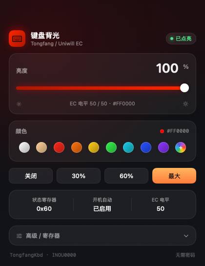

# 键盘背光 · TongfangKbd

给同方（Uniwill）方案笔记本在 macOS 下点亮键盘背光的驱动 + 图形界面。

黑苹果装完之后常见的一个毛病：OpenCore 引导阶段背光是亮的，进系统就灭了 —— 因为 macOS 没有对应驱动去接管这颗 EC。这个项目直接通过 ACPI 的 `ECRR` / `ECRW` 读写嵌入式控制器，把背光重新点亮，并提供一个 App 调亮度和颜色。



## 验证环境

| 项目 | 值 |
|---|---|
| 机型 | 机械革命（同方 / Uniwill 方案） |
| ACPI 设备 | `\_SB.INOU`，HID `INOU0000` |
| 系统 | macOS 15.7.8 (x86_64) |
| 引导 | OpenCore |

> 只有 EC 里存在 `INOU0000` 且 `0x0740`（PROJECT_ID）可读的机器才适用。不同同方模具的寄存器布局可能不同，**先读快照再动手**。

## 原理

EC 通过 ACPI 暴露两个方法：

```
ECRR(reg)        -> 读一个字节
ECRW(reg, value) -> 写一个字节
```

每次调用后要等约 6 ms，否则 EC 会丢命令。

背光相关寄存器：

| 地址 | 名称 | 说明 |
|---|---|---|
| `0x0740` | PROJECT_ID | 机型标识，实测 `0x19` |
| `0x0765` | SUPPORT_1 | 实测 `0xA1` |
| `0x0766` | SUPPORT_2 | bit5 = China Mode，本机 `0x94` |
| `0x0767` | TRIGGER | 写 `0x20` 让 EC 应用新设置，自清零 |
| `0x0768` | STATUS | 实测恒为 `0x00` |
| `0x0769/6A/6B` | R/G/B 当前电平 | 0–50 |
| `0x076C/6D/6E` | R/G/B 默认电平 | EC 周期任务会用这组值覆盖上面三个，必须同步写 |
| `0x078C` | KBD_STATUS | bit7-5 = 亮度档（0–3），bit4 = 应用位 |

点亮的关键是 `0x078C` 要写成 **`0x70`**（第 3 档 + 应用位）。写 `0x01` 或者默认的 `0x00` 都不亮，这是折腾最久的地方。点亮后 EC 会把 bit4 清掉，回读变成 `0x60`，属于正常现象。

完整序列（白光，电平 50）：

```
0x0769..0x076E <- 0x32 (×6)
0x078C        <- 0x70
0x0767        <- 0x20
```

调色就是把 `0x0769/6A/6B` 与 `0x076C/6D/6E` 换成不同的 RGB 分量，三通道可以独立保持，EC 不做钳位。

## 安装

### 1. 构建 kext

只需要 Command Line Tools，不需要完整 Xcode：

```sh
cd kext
./build.sh
```

产物是 `kext/TongfangKbd.kext`（ad-hoc 签名，x86_64）。

### 2. 放进 OpenCore

```sh
# 挂载 EFI
sudo diskutil mount disk0s1

cp -R kext/TongfangKbd.kext /Volumes/EFI/EFI/OC/Kexts/
```

在 `config.plist` 的 `Kernel → Add` 里登记（注意 `MinKernel` / `MaxKernel` 留空即可）：

```xml
<dict>
    <key>Arch</key><string>x86_64</string>
    <key>BundlePath</key><string>TongfangKbd.kext</string>
    <key>Enabled</key><true/>
    <key>ExecutablePath</key><string>Contents/MacOS/TongfangKbd</string>
    <key>MaxKernel</key><string></string>
    <key>MinKernel</key><string></string>
    <key>PlistPath</key><string>Contents/Info.plist</string>
</dict>
```

改 `config.plist` 前先备份，改完重启。

> macOS 15 起运行时不接受第三方 kext（`kmutil` 报 `Code=28 requires a reboot`），只能走 OC 注入。

### 3. 验证

```sh
ioreg -c TongfangKbd -r -l -w0
sysctl kern.tfkbd_level
```

`start()` 会在开机 5s / 20s / 40s / 42s 各写一份寄存器快照到 IORegistry 属性 `TFKBD-A/B/C/E`，用来判断是「没写进去」还是「写进去又被 EC 覆盖了」。

## 图形界面（可选）

```sh
cd app
./build.sh          # 生成 键盘背光.app
open 键盘背光.app
```

App 通过 `kern.tfkbd_*` 这组 sysctl 和 kext 通信。这些节点带 `CTLFLAG_ANYBODY`，所以**普通用户直接就能写，不需要 sudo**。

功能：亮度滑块、关闭/30%/60%/最大、9 个预设色 + 系统调色盘任意取色、寄存器网格、任意地址写入。

kext 侧提供四个节点：

| 节点 | 作用 |
|---|---|
| `kern.tfkbd_reg` | 目标寄存器地址 |
| `kern.tfkbd_val` | 要写入的值 |
| `kern.tfkbd_level` | cmd=3 使用的电平，0–50 |
| `kern.tfkbd_cmd` | 1 裸写 · 2 裸读 · 3 完整应用 · 4 开 China Mode · 5 快照 · 6 关 China Mode |

命令行也能直接用：

```sh
# 白光，50 档
sudo sysctl kern.tfkbd_level=50 kern.tfkbd_val=0x70 kern.tfkbd_cmd=3
```

## 已知限制

- **权限**：sysctl 节点是 `ANYBODY`，任何本地用户都能改背光。个人机器够用，多用户环境不合适。
- **重启丢颜色**：kext 开机自动应用固定写白光，颜色只保留在 EC 里直到断电。要持久化得再加一个登录时还原的 LaunchAgent。
- **单色机型**：部分同方模具的灯珠是单色白光，三个通道能写进去但看不出来，只有亮度有效。
- 只支持 x86_64 的同方机型，未在其它模具上验证。
- `0x078C` 的回读值会被 EC 改（`0x70` → `0x60`），判断是否点亮请看「是否非 0」。

## 免责

改 EFI 有风险，动之前先备份整个 EFI 分区。寄存器地址是实测出来的，不保证适用于所有同方机型，写错地址理论上可能影响其它 EC 功能。

## License

MIT
